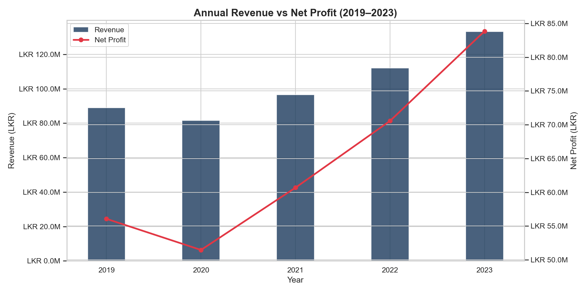
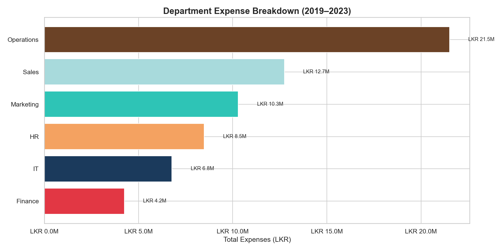
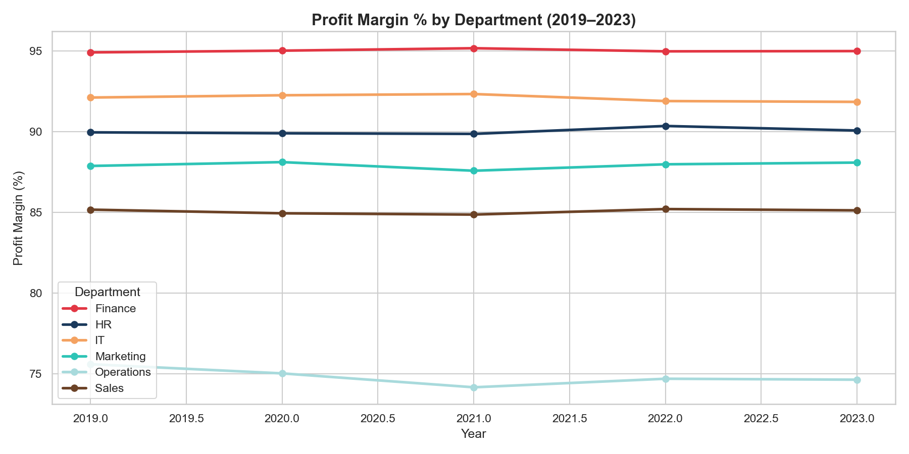
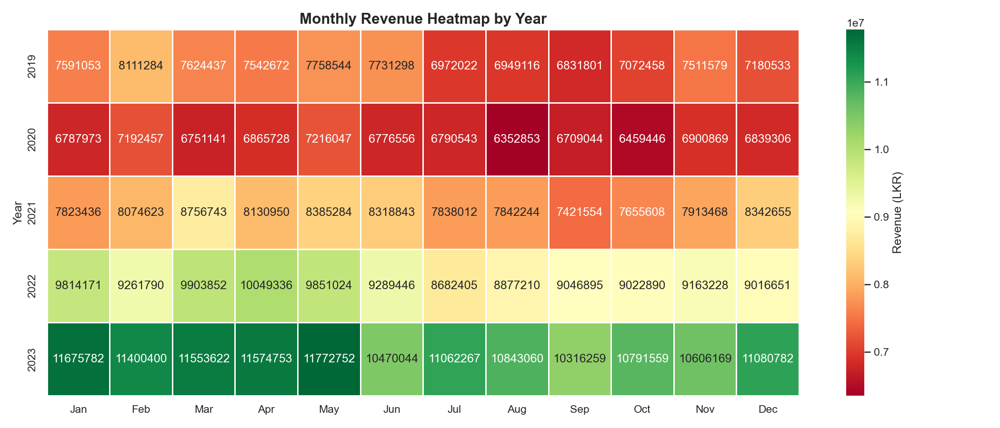
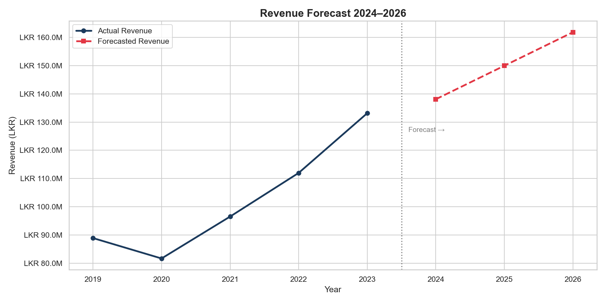
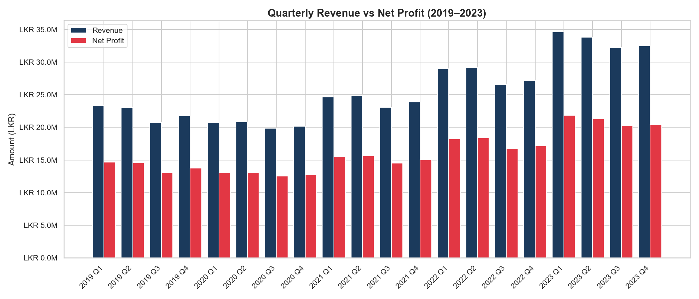

# 💹 Ceylon Tech Solutions | Financial Performance Analysis (2019–2023)

## 📌 Project Overview
This project delivers a comprehensive financial performance analysis for
**Ceylon Tech Solutions**, a fictional Sri Lankan technology company.
The analysis covers 5 years of financial data across 6 departments,
examining revenue trends, expense breakdowns, profit margins, and
providing a **3-year revenue forecast** through 2026.

---

## 🎯 Business Questions Answered
- How has annual revenue and net profit trended from 2019 to 2023?
- Which departments consume the most expenses?
- How do profit margins vary across departments over time?
- What are the seasonal revenue patterns month by month?
- What is the projected revenue for 2024, 2025 and 2026?
- How does quarterly performance compare across all 5 years?

---

## 📊 Key Findings
- Revenue **dipped in 2020** due to COVID-19 impact but recovered strongly
- Revenue grew **47% from 2019 to 2023** — from LKR 89M to LKR 132M
- **Operations** is the highest expense department at LKR 21.5M
- **Finance department** maintains the highest profit margin at ~95%
- **2023 Q1** was the strongest quarter with LKR 35M revenue
- Revenue forecast projects **LKR 160M by 2026** at current growth rate
- **January and May** consistently show peak monthly revenues

---

## 🛠️ Tools & Technologies
| Tool | Purpose |
|------|---------|
| Python | Data generation, analysis, visualization |
| Pandas | Data manipulation and aggregation |
| Matplotlib | Financial charts and dual-axis plots |
| Seaborn | Heatmap visualization |
| NumPy | Linear regression for forecasting |
| Excel | Financial summary workbook |

---

## 📁 Project Structure
```
project3-financial-analysis/
│
├── data/
│   └── ceylon_tech_financials.csv     # Dataset (360 rows)
│
├── charts/
│   ├── chart1_revenue_vs_profit.png
│   ├── chart2_department_expenses.png
│   ├── chart3_profit_margin_trend.png
│   ├── chart4_monthly_revenue_heatmap.png
│   ├── chart5_revenue_forecast.png
│   └── chart6_quarterly_performance.png
│
├── generate_dataset.py                # Dataset generation script
├── analysis.py                        # Analysis and visualization script
└── README.md                          # Project documentation
```

---

## 📈 Visualizations

### Annual Revenue vs Net Profit


### Department Expense Breakdown


### Profit Margin % by Department


### Monthly Revenue Heatmap


### Revenue Forecast 2024–2026


### Quarterly Revenue vs Net Profit


---

## 🔮 Revenue Forecast Methodology
A **linear regression model** was applied to annual revenue data
(2019–2023) to project future performance:

- **2024 Forecast:** LKR ~138M
- **2025 Forecast:** LKR ~149M
- **2026 Forecast:** LKR ~160M

Growth assumes continuation of post-COVID recovery trajectory
at approximately **8-10% annual growth rate**.

---

## 💡 Financial Recommendations
- **Optimise Operations costs** — highest expense department;
  a 10% reduction saves LKR 2.1M annually
- **Leverage IT efficiency** — lowest expense ratio suggests
  technology investments are yielding strong returns
- **Q3 revenue dip** — consistent across all years; targeted
  campaigns in July-September could smooth revenue curve
- **Scale Finance department model** — highest profit margin
  at 95%; replicating its cost discipline across departments
  would significantly boost overall margins
- **Plan for 2024 growth** — forecast suggests LKR 138M revenue;
  Operations and HR capacity should be scaled accordingly

---

## 👩‍💻 Author
**Fathima Nuha** | Data Analyst
📍 Sri Lanka
[](https://www.linkedin.com/in/your-linkedin-url)
[](https://github.com/nuha-dataanalyst)